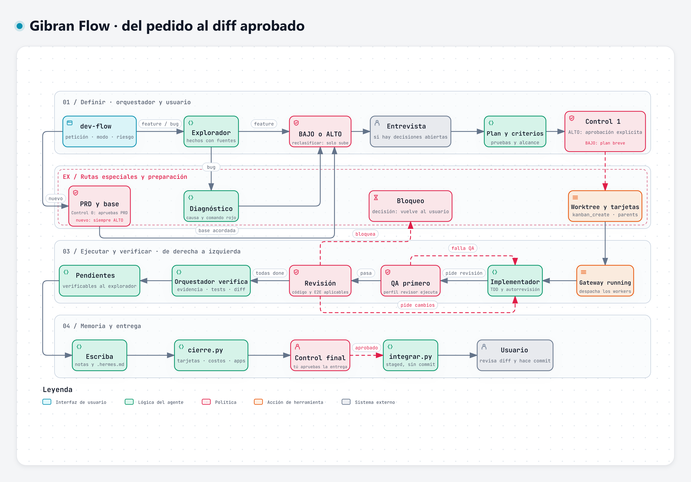

# Gibran Flow para Hermes Agent

Un flujo de desarrollo **guiado por decisiones humanas** sobre Hermes Agent en
Windows: explorar antes de planear, implementar por tarjetas, verificar con otro
perfil y entregar un diff antes de integrar. No es un fork de Hermes ni un servicio
de ejecución aislado: son **skills, SOULs, hooks y scripts** que se instalan sobre
una instalación existente.

La línea de referencia es **Hermes Agent v0.22.x**. Las herramientas de Kanban,
hooks y perfiles deben existir en tu versión: esto no promete compatibilidad con
cualquier versión anterior o futura. La distribución pública conserva la lógica
actual del flujo, con ejemplos y material operativo sanitizados.

> **Publicado y verificado:** [abre el diagrama interactivo en GitHub Pages](https://gibrantrm.github.io/Gibran-Hermes-Flow/).
> El README muestra una imagen; al pulsarla se abre el visor completo.
> [Detalles de publicación](PUBLICACION.md).

## Diagrama del flujo

[](https://gibrantrm.github.io/Gibran-Hermes-Flow/)

[Abrir visor interactivo](https://gibrantrm.github.io/Gibran-Hermes-Flow/) ·
[Abrir imagen SVG](docs/diagrama/gibran-flow.svg) ·
[HTML interactivo autocontenido](docs/diagrama/gibran-flow.html) ·
[JSON editable](docs/diagrama/candidate.json) ·
[Cómo abrirlo y reproducirlo](docs/diagrama/README.md)

La imagen se muestra directamente en GitHub. El README **no ejecuta JavaScript**
ni incrusta el visor con un iframe. Para interactuar, abre el enlace de Pages
o descarga el HTML y ábrelo en tu navegador. Pages publica únicamente los
artefactos del diagrama, no el árbol completo del repositorio.

## Recorrido rápido

1. Pides un cambio al orquestador: `dev-flow` identifica **feature, bug o nuevo**.
2. El explorador investiga; los hechos llevan fuentes y las decisiones se preguntan.
3. Se clasifica riesgo **BAJO/ALTO**, se entrevista cuando hace falta y se prepara el plan.
4. Se trabaja en un worktree por feature y repo, mediante tarjetas Kanban.
5. El implementador pide revisión; el perfil revisor ejecuta **QA primero** y luego
   revisión. Si hay fallos, pide cambios o bloquea; no los arregla por su cuenta.
6. Se verifican pendientes, el escriba deja memoria y `cierre.py` prepara el cierre.
7. Tú apruebas el **Control final**; entonces `integrar.py` deja los cambios staged
   en la rama de origen, sin commit. Revisas el diff y haces el commit.

## Requisitos y preparación

- Windows, Git y una instalación funcional de Hermes Agent con Python y **PyYAML**.
- Perfiles Hermes llamados `default`, `implementador` y `revisor`, creados previamente
  con el mecanismo de perfiles de tu versión. El instalador **omite** los inexistentes:
  no instala Hermes ni crea cuentas o perfiles.
- Configuración propia de proveedores/modelos y sus permisos. No se incluyen
  credenciales, `config.yaml`, bases Kanban ni directorios personales de Hermes.
- Para .NET, el SDK que declare el proyecto. Para navegador, Node/npm y el MCP de
  Playwright configurado por ti; el instalador fija la versión de una configuración
  ya existente a `@playwright/mcp@0.0.83`, no crea el servidor MCP.
- Las integraciones de BD/documentación son opcionales y requieren configuración
  propia. Ningún acceso ni permiso de escritura en BD viene incluido.

### Instalar

Clona con el nombre local **hermes-flow**. Es importante: el instalador reconoce
sus hooks anteriores mediante la cadena `hermes-flow/hooks/`. Renombrar el clon
puede hacer que sucesivas instalaciones acumulen hooks.

```powershell
git clone https://github.com/Gibrantrm/Gibran-Hermes-Flow.git hermes-flow
Set-Location .\hermes-flow

# Usa el Python de TU instalación de Hermes, no un Python arbitrario.
$python = Read-Host 'Ruta del ejecutable Python de Hermes'
& $python .\instalar.py --solo-mostrar
& $python .\instalar.py
```

**Precaución:** `--solo-mostrar` imprime la configuración resultante completa,
incluyendo valores ya presentes en tus perfiles. Revísala solo en tu terminal:
no pegues esa salida en issues, chats ni logs públicos.

El instalador busca los perfiles bajo `$env:LOCALAPPDATA\hermes` y
`profiles\implementador` / `profiles\revisor`. No usa una ruta fija de otro usuario
ni ofrece un parámetro para cambiar esa raíz. Detecta la ruta del clon y el
ejecutable Python, agrega `<clon>/skills` a **`skills.external_dirs`**, registra
hooks, ajusta herramientas y copia los SOULs. Antes de escribir hace respaldos
con sufijo `.antes-gibran-<fecha>.bak`. No lo ejecutamos durante la publicación.

Reinicia tus sesiones tras instalar. Comprueba que `skill_view("dev-flow")`
encuentra la skill. El contenido anidado `skills/gibran-flow/` se conserva completo.
No copies a mano solo un `SKILL.md`: sus referencias también son necesarias.

Para localizar repos relacionados, copia `local\workspace.example.yaml` a
`local\workspace.yaml` y rellena `raices` con tus carpetas. Ese archivo es personal
y está ignorado por Git. El catálogo público empieza vacío intencionalmente.

### Perfiles, modelos y responsabilidades

| Perfil / mecanismo | Responsabilidad | Configuración actual del instalador |
|---|---|---|
| `default` | Orquestador: clasifica, entrevista, planea, crea tarjetas y verifica entrega | Conserva tu modelo principal; no impone uno |
| `delegate_task` | Explorador y escriba acotados; no son workers Kanban | `--hijos copilot` selecciona Haiku; `--hijos anthropic` cambia proveedor |
| `implementador` | Una tarjeta, TDD, mutación y autorrevisión; no cierra la tarjeta | Copilot `claude-haiku-5.5`; respaldo Anthropic `claude-haiku-5-5` |
| `revisor` | QA, revisión de código, E2E cuando corresponde; no edita código | Copilot `gpt-6.1-sol`; respaldo Anthropic `claude-sonnet-5` |

`agente-producto` prepara el mini-PRD de un proyecto nuevo.
`agente-revisor-db`, `revisor-csharp` y `revisor-seguridad` son módulos de revisión;
`stack-dotnet` aporta los comandos y convenciones .NET. No son perfiles adicionales.
El módulo de seguridad es una lista de revisión, **no una certificación**.

Los nombres de modelos son los que contiene `instalar.py`, no una garantía de
disponibilidad o precio de los proveedores. El respaldo del revisor cambia de
familia de modelo. Los hijos de `delegate_task` no tienen respaldo automático;
el flujo pide cambiar proveedor y abrir otra sesión ante cuota/429.

```powershell
& $python .\instalar.py --hijos copilot
# Alternativa con tu acceso Anthropic ya configurado:
& $python .\instalar.py --hijos anthropic
```

Este cambio afecta al perfil `default` para la próxima sesión. No ejecutes ambos
por costumbre: elige el proveedor que quieras usar.

## Decisiones y controles

La entrada es una petición normal de desarrollo al orquestador. Su SOUL carga
`dev-flow`; no hay un comando de terminal `dev-flow`.

- **Feature:** exploración, reclasificación de riesgo y motor Kanban completo.
- **Bug:** exploración y diagnóstico con hipótesis verificables. Debe existir un
  comando rojo; en lógica determinista la causa puede documentarse primero por
  lectura y la tarjeta exige que el implementador produzca el rojo. Luego usa el
  mismo motor de feature y demuestra verde con el comando original.
- **Nuevo:** siempre ALTO. Mini-PRD y **Control 0**, elección de base/stack, plan de
  un walking skeleton y Control 1. El primer commit vacío lo hace el usuario.

**ALTO** incluye cambios de contrato o esquema, escrituras de datos, seguridad,
datos sensibles, configuración compartida, más de cinco archivos existentes o
dudas no resueltas. **BAJO** no significa sin revisión: ambos pasan por Kanban,
QA, revisor y Control final. El riesgo se reevalúa tras explorar y solo sube
automáticamente; bajarlo lo decide el usuario.

La entrevista resuelve decisiones abiertas por rondas con recomendaciones. Los
hechos se investigan, no se votan. No se escribe el plan antes de recibir la
última respuesta. Para ALTO, petición de `/reasoning high`, plan y Control 1 van
en mensajes separados; después se solicita `/reasoning medium`. Fuera de la TUI
se usa la opción `--reasoning` de Hermes.

**Control 1:** en ALTO se espera aprobación explícita del plan; en BAJO se muestra
el plan breve y se continúa, salvo «Sin test», que siempre requiere decisión.
Los criterios aprobados no se cambian silenciosamente ante un bloqueo.

Fuentes: [router](skills/gibran-flow/dev-flow/SKILL.md),
[riesgo](skills/gibran-flow/dev-flow/references/riesgo.md),
[entrevista](skills/gibran-flow/dev-flow/references/entrevista.md),
[feature](skills/gibran-flow/modo-feature/SKILL.md),
[bug](skills/gibran-flow/modo-bug/SKILL.md),
[nuevo](skills/gibran-flow/modo-nuevo/SKILL.md).

## Tarjetas, gateway y verificación

El orquestador crea tarjetas con `kanban_create`: asignado `implementador`,
`workspace_kind: "dir"`, worktree explícito, criterios/archivos/pruebas en el body,
dependencias en `parents` y `max_runtime_seconds: 2700`. La TUI recibe avisos de
tarjetas suscritas; no se debe inventar su estado a partir de que ya pasó tiempo.

**El despachador vive en el gateway: debe estar running.** Si una tarjeta sigue
`ready` unos dos minutos, consulta primero:

```powershell
hermes status
hermes kanban diagnostics
```

Si está detenido, el usuario puede iniciar `hermes gateway start` o configurar
`hermes gateway install`. El gateway no administrado puede cerrarse tras diez
minutos de inactividad (`gateway.unmanaged_idle_exit_seconds`); crear tarjetas
no lo despierta. Con gateway corriendo y diagnóstico revisado, `/despachar`
ejecuta `hermes kanban dispatch`. No se lanzan workers durante esta publicación.

El implementador solicita `kanban_request_review(reviewer="revisor")`.
El revisor ejecuta QA y después revisión; usa `kanban_request_changes`,
`kanban_block` o `kanban_complete`. El tope de su SOUL es tres rondas de cambios:
no pide una cuarta. Las tarjetas comparten el worktree; revisiones sobre archivos
que cambiaron en paralelo pueden bloquearse legítimamente.

Las pruebas se autorizan por tarea: especifica comando, filtro, ambiente y
efectos permitidos. **El texto de una tarjeta por sí solo no impide ejecutar
una suite completa**: el implementador también tiene instrucciones de línea
base/suite del proyecto. Las guardias no limitan todos los comandos ni efectos
laterales de un test. Cero tests encontrados no es éxito.

En .NET, `scripts/dotnet_seguro.py` serializa compilaciones del worktree compartido;
no convierte pruebas con escrituras en pruebas de solo lectura. Las E2E usan el
filtro de la tarjeta y el acumulado de la feature, no toda la categoría E2E.
Sin arnés, el plan crea tarjeta de verificación en navegador para el revisor.

## Apps locales y `--tarea`

Ejecuta estos comandos **desde el worktree de la tarea**, con la ruta del flujo
guardada en `$flow`. Son ejemplos para un proyecto que ya declare `pnpm dev`;
no instalan dependencias ni autorizan levantar una app con escrituras de BD.

```powershell
$flow = Read-Host 'Ruta de tu clon hermes-flow'
$tarea = Read-Host 'ID real de la tarjeta'
& $python "$flow\scripts\app_local.py" iniciar --tarea $tarea --puerto auto -- pnpm dev --port '{puerto}' --strictPort
& $python "$flow\scripts\app_local.py" estado
& $python "$flow\scripts\app_local.py" detener --tarea $tarea
```

`--tarea` mitiga que la shell no reciba `HERMES_KANBAN_TASK`; usa el mismo ID al
iniciar y detener. `auto` reserva en 51300–51399; un puerto fijo ocupado falla,
no se reutiliza ni mata a su dueño. `--copia` permite ejecutar una copia de
binarios y sustituye `{copia}` en el comando; `--env` agrega variables.

La versión publicada contiene la corrección **H1**: un listener sin registro
solo se informa con PID/puerto. No se mata ni se borra su posible copia por
coincidir con el rango. Las apps de otras tarjetas activas se protegen; un
registro válido no equivale a un sandbox ni a una prueba infalible de propiedad.

## Pendientes, escriba y cierre

Terminadas las tarjetas, el orquestador lee la evidencia del revisor, verifica
build/tests/diff y devuelve defectos de la tarea como tarjetas de corrección
(no los arregla al margen de revisión). Los hallazgos previos o fuera de alcance
se presentan al usuario. Hay topes de dos vueltas por hallazgo y tres tarjetas
de corrección en total.

Los **pendientes verificables** vuelven juntos al explorador con evidencia;
los que requieren permisos o escrituras no autorizadas se declaran como riesgos
no verificables, con motivo concreto. Después el escriba deja una nota en
`docs/hermes/notas/`, su índice y reglas de `.hermes.md` en el worktree,
distinguiendo hechos de supuestos.

`cierre.py` lee Kanban en solo lectura, cuenta tarjetas/revisiones, calcula
equivalentes, agrega una fila local de métricas y reporta apps registradas vivas.
**Escribe archivos de métricas:** no es un comando de inspección sin efectos.

```powershell
& $python "$flow\scripts\cierre.py" --worktree $worktree --rama $rama --modo feature --riesgo ALTO --e2e 'no aplica'
# SOLO después de aprobar el Control final:
& $python "$flow\scripts\integrar.py" --worktree $worktree --rama $rama
```

Define `$worktree` y `$rama` con los valores de tu tarea. Usa preferentemente el
comando exacto que imprime el cierre. No ejecutamos cierre ni integración al
publicar esta copia.

El [Control final](skills/gibran-flow/modo-feature/references/control-final.md)
tiene siete secciones: qué cambió, evidencia, hallazgos abiertos, riesgos
aceptados, despliegue, memoria del repo y cierre. Integrar después de la aprobación
aplica el parche al índice de la rama principal abierta, guarda un respaldo local
y elimina el worktree y su rama. Puede fallar ante cambios previos, apps vivas o
conflictos; lee la salida y no lo rodees. **No hace commit ni push.**

## Costos, permisos y límites

- `/costos-inicio` marca el inicio; `/costos` muestra el resumen. Los hooks registran
  uso y duración localmente; no se publican esos logs.
- `hooks/precios.json` conserva tarifas y tipo de cambio **orientativos** del flujo.
  Los totales USD/MXN/AIC son **equivalentes estimados**, no factura, cuota
  garantizada ni medición económica vigente. Revisa tarifas antes de compararlos.
- No autorices escrituras en DEV/PROD implícitamente. Usa identidades de BD con
  permisos mínimos; PROD es solo lectura en las reglas del flujo. Incluso tests
  y arranques de apps pueden migrar o sembrar datos: revisa sus efectos.
- Los hooks son **defensa parcial, no sandbox ni garantía absoluta**. Comparan
  texto, rutas y estados observables; hay herramientas y formas de ejecución que
  no cubren. `hooks/comun.py` devuelve respuesta vacía ante excepciones: no todos
  los fallos internos se traducen en bloqueo, aunque se configure `fail_closed`.
- No incluyas credenciales en tarjetas ni archivos; no publiques configs personales.
  El flujo prohíbe commits/push de agentes durante tareas normales. Esta publicación
  fue una operación separada autorizada por el propietario.
- `instalar.py --certs` es opcional: construye bundles con raíces ya confiadas por
  Windows y requiere `cryptography`/`certifi`. No configura variables de entorno,
  no desactiva TLS y no debe usarse sin entender la política de confianza local.

## Prueba acotada de la copia pública

Se incluye `tests/test_app_local.py` (12 casos). Levanta únicamente servidores de
prueba loopback, con registro/rango propios; no ejecuta Hermes workers ni apps de
negocio. El runner público simula **únicamente la conexión a Kanban** como un
tablero vacío; no abre ni escribe una base real. Los casos de concurrencia fijan
sus propios estados. Usa el Python de Hermes:

```powershell
& $python -B .\tests\run_app_local.py
```

No uses `unittest discover` general para reproducir esta publicación: otras
fixtures del entorno de desarrollo realizan operaciones adicionales y no se
incluyen en esta copia. Los archivos de prueba quedan bajo `.verification/`,
ignorado por Git. Ejecutar directamente `test_app_local.py` sin Kanban puede
fallar: la protección conservadora mantiene apps sin dueño ante una BD ilegible.
Que estos 12 casos pasen no certifica todo el flujo ni la integración real con Kanban.

## Alcance público y licencias

Consulta [PUBLICACION.md](PUBLICACION.md) para exclusiones y límites de validación.
Se conserva el flujo, no su historial local, datos empresariales o incidentes.
No se ha elegido una licencia para el trabajo original de Gibran Flow:
**publicar el repositorio no concede por sí solo una licencia de reutilización**.
Las atribuciones de terceros tienen su alcance propio en
[THIRD_PARTY_NOTICES.md](THIRD_PARTY_NOTICES.md).
